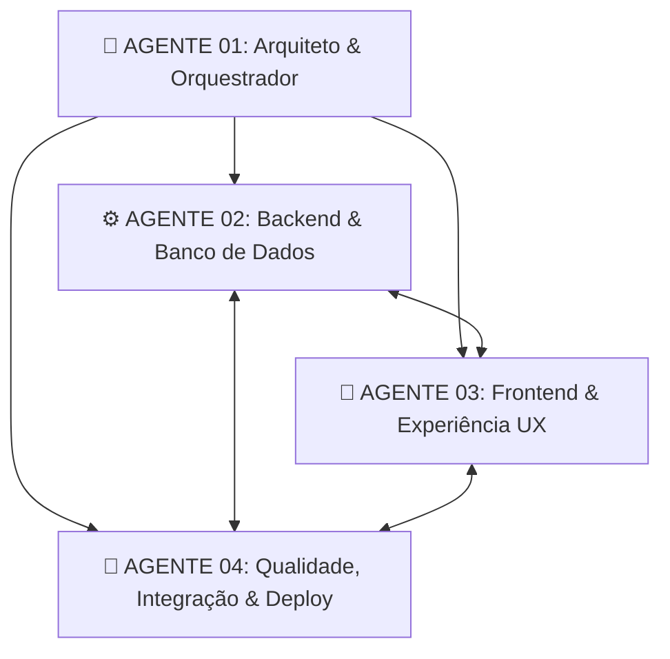
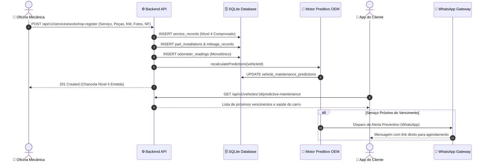

# DNA AUTO — Arquitetura do Sistema e Estrutura de Agentes Autônomos

> **Documento Oficial de Engenharia & Arquitetura**  
> **Versão:** 1.0.0 — MVP Production-Ready  
> **Modelo de IA Autorizado:** Exclusivamente **Gemini** (Google Antigravity / Gemini 3.8)

---

## 1. Visão Geral da Plataforma

O **DNA AUTO** é uma plataforma veicular integrada de ponta a ponta, desenvolvida para transformar a manutenção preventiva, o histórico de serviços e a transparência automotiva no Brasil. Conecta diretamente proprietários de veículos a oficinas mecânicas credenciadas, fornecendo:

- **Passaporte DNA Veicular Permanente:** Código criptográfico único por chassi/placa (ex: `DNA-BR-XXXX-XXXX-XXX`).
- **Dossiê 360° com 4 Níveis de Comprovação:** Desde serviços declarados pelo proprietário até serviços Nível 4 auditados com peças, nota fiscal e laudo técnico chancelado pela oficina.
- **Motor de Manutenção Preditiva OEM:** Algoritmo dinâmico calibrado com 35 regras de fábrica (óleo, filtros, correias, freios, fluidos) e desgaste baseado no hodômetro oficial.
- **Hodômetro Monotônico Protegido:** Bloqueio criptográfico de retrocesso de quilometragem e auditoria anti-fraude.
- **Duas Aplicações PWA Dedicadas:**
  - **App do Cliente (`cliente.app` / `/cliente`):** Garagem digital, alertas preventivos, rede de oficinas credenciadas, gastos e histórico.
  - **ERP da Oficina (`oficina.app` / `/oficina`):** Recepção por placa, lançamento de serviços em 4 etapas, ordens de serviço, WhatsApp oficial, faturamento e clientes.

---

## 2. Estrutura dos 4 Agentes Autônomos Especialistas (Gemini)

Em conformidade rigorosa com a diretriz do projeto, a governança técnica é executada por quatro agentes lógicos independentes utilizando **exclusivamente o modelo Gemini**:

### Agente 01 — Arquiteto e Orquestrador
- **Escopo:** Coordenação executiva, governança de arquitetura, priorização do backlog P0 a P3, resolução de dependências técnicas e aprovação de merges.
- **Artefatos sob custódia:**
  - `docs/AI_ARCHITECTURE.md`
  - `docs/AI_PROJECT_STATUS.md`
  - `docs/AI_TASK_QUEUE.md`
  - `diario de bordo.md` / `DIARIO_DE_BORDO.md` / `README.md`

### Agente 02 — Engenheiro Backend e Banco de Dados
- **Escopo:** APIs REST (Express 5), banco de dados relacional SQLite WAL (`better-sqlite3`), modelo transacional, regras OEM de manutenção preditiva, integração de telemetria OBD2, gateways WhatsApp (Baileys & Evolution API) e cobrança PIX (AbacatePay).
- **Diretriz de Segurança:** Proibidas migrações destrutivas sem aprovação; preservação da integridade referencial em 44 tabelas.

### Agente 03 — Engenheiro Frontend e Experiência do Usuário (UI/UX)
- **Escopo:** App do Cliente (`cliente.app`), ERP Operacional da Oficina (`oficina.app`), Portal Landing (`public/index.html`), componentes reutilizáveis, responsividade, PWA/TWA para Google Play Store.
- **Diretriz Visual:** Preservação integral da identidade visual oficial (paleta azul-marinho DNA AUTO, tipografia Inter/Outfit, sem purple, sem templates genéricos).

### Agente 04 — Engenheiro de Qualidade, Integração e Entrega (QA)
- **Escopo:** Bateria de testes automatizados (`test/api.test.js`), validação de integridade end-to-end, testes de regressão, segurança, conformidade LGPD e preparação para deploy contínuo no Render.
- **Métrica Mandatória:** Nenhuma alteração é comitada sem 100% de aprovação (56/56 testes).

---

## 3. Diagrama de Integração do Fluxo Crítico

---

## 4. Estrutura do Banco de Dados (44 Tabelas)

1. **Autenticação e Permissões:** `permissions`, `roles`, `role_permissions`, `users`
2. **Oficinas e Multi-Tenancy:** `workshops`, `workshop_users`, `workshop_billing_balances`, `workshop_pix_charges`
3. **Veículos e Passaporte:** `vehicles`, `vehicle_dna`, `owners`, `ownership_transfers`, `vehicle_documents`, `vehicle_photos`
4. **Histórico de Serviços e Peças:** `maintenance_records`, `service_records`, `parts`, `part_installations`, `invoices`, `mileage_records`
5. **Auditoria e Financeiro Veicular:** `taxes`, `fines`, `debts`, `auctions`, `market_values`, `fipe_values`, `health_scores`, `reports`, `audit_logs`
6. **Planos e Comissões:** `pricing_plans`, `dna_activations`, `commissions`, `integrations`
7. **WhatsApp & Mensageria:** `whatsapp_sessions`, `whatsapp_messages`, `whatsapp_templates`
8. **Cliente & Ativações:** `client_activations`, `notifications`
9. **Telemetria, OBD2 & Hodômetro:** `monitoring_preferences`, `odometer_readings`, `vehicle_trips`, `trip_classification_metrics`
10. **Motor Preditivo OEM:** `maintenance_rules`, `vehicle_maintenance_predictions`

---

## 5. Serviços Externos e Gateways Integrados

- **API Placas / WDAPI2:** Consulta veicular oficial em tempo real com FIPE e dados cadastrais.
- **Baileys (Socket Direto) + Evolution API v2 (Cloud Gateway):** Comunicação de alta resiliência com proteção anti-bloqueio.
- **AbacatePay:** Cobrança PIX automatizada e conciliação instantânea via webhook.
- **Keep-Alive Service:** Garantia de uptime 24/7 na nuvem Render.

